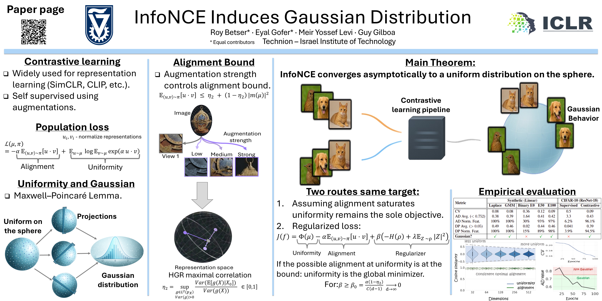

# InfoNCE Induces Gaussian Distribution

[](https://arxiv.org/abs/2602.24012)
[](https://openreview.net/group?id=ICLR.cc%2F2026%2FConference)
[](https://www.python.org/)

> **Official repository** for the paper:  
> 📄 **InfoNCE Induces Gaussian Distribution**  
> 🎤 Oral presentation at **ICLR 2026**

📄 [Paper](https://arxiv.org/abs/2602.24012) • 🌐 [Webpage](https://rbetser.github.io/InfoNCE-induces-Gaussian-distribution/) • 🎥 [Video](https://www.youtube.com/watch?v=KKaTzjC-hwk) • ✍️ [Blog](https://medium.com/@rbetser93/why-contrastive-learning-naturally-produces-gaussian-representations-bc4058a8d46c)

<p align="center">
  
</p>

Small reproduction scripts for the core claim behind "InfoNCE Induces Gaussian Distribution". The repo contains two synthetic experiments and one CIFAR-10 ResNet-18 setup comparing supervised and contrastive training under matched data augmentation and optimization settings.

## 📦 Contents

- `run_single.py`: linear InfoNCE encoder on synthetic Laplace data.
- `run_single_gmm.py`: linear InfoNCE encoder on synthetic Gaussian-mixture data.
- `cifar10_resnet18/train_contrastive.py`: CIFAR-10 contrastive training with final Gaussianity diagnostics for both backbone and projector spaces.
- `cifar10_resnet18/train_supervised.py`: matched CIFAR-10 supervised baseline with final Gaussianity diagnostics on the backbone space.
- `cifar10_resnet18/diagnostics.py`: shared Anderson-Darling and D'Agostino-Pearson diagnostics.

## ⚙️ Requirements

Install the dependencies with:

```bash
pip install -r requirements.txt
```

The checked dependency surface for this directory is:

- `numpy`
- `scipy`
- `torch`
- `torchvision`

## 🚀 Running The Scripts

Run the synthetic experiments from the project directory:

```bash
python run_single.py
python run_single_gmm.py
```

Run the CIFAR-10 experiments from the CIFAR subdirectory so the local imports resolve as written:

```bash
cd cifar10_resnet18
python train_contrastive.py
python train_supervised.py
```

The CIFAR scripts download the dataset into `./data` on first run and write checkpoints in the same working directory:

- `contrastive_checkpoint.pt`
- `supervised_checkpoint.pt`

## 📉 Output Behavior

The CIFAR scripts now default to minimal console output:

- one startup line with the active configuration
- one compact progress line per epoch
- one final Gaussianity report at the end of training

If you want the old per-epoch Gaussianity dumps and CSV accumulation back, set `RUN_PER_EPOCH_DIAGNOSTICS = True` inside the relevant training script.

## 📚 Citation

```bibtex
@inproceedings{betser2026infonce,
  title={InfoNCE Induces Gaussian Distribution},
  author={Betser, Roy and Gofer, Eyal and Levi, Meir Yossef and Gilboa, Guy},
  booktitle={International Conference on Learning Representations (ICLR)},
  year={2026},
  note={Oral presentation}
}
```

## 🧠 Notes

- The CIFAR model is a CIFAR-adapted ResNet-18 with a 3x3 stem and no max-pool.
- The contrastive script evaluates Gaussianity in both the 512-dim backbone space and the 128-dim projector space.
- The supervised script evaluates Gaussianity in the 512-dim backbone space for the cleanest comparison against the contrastive backbone.
